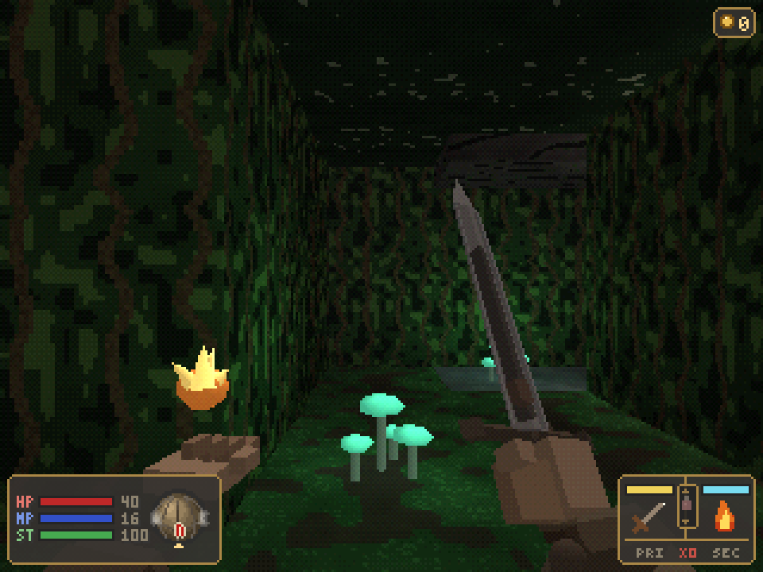
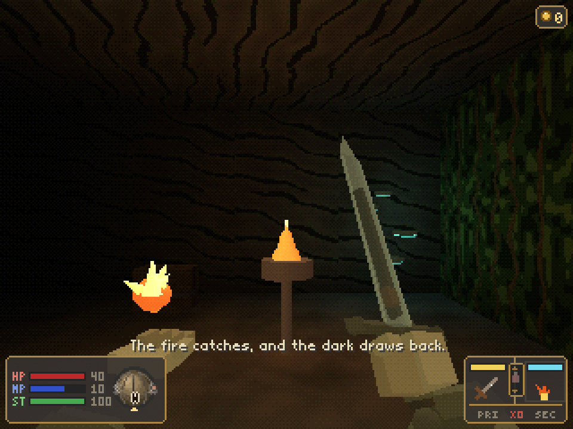
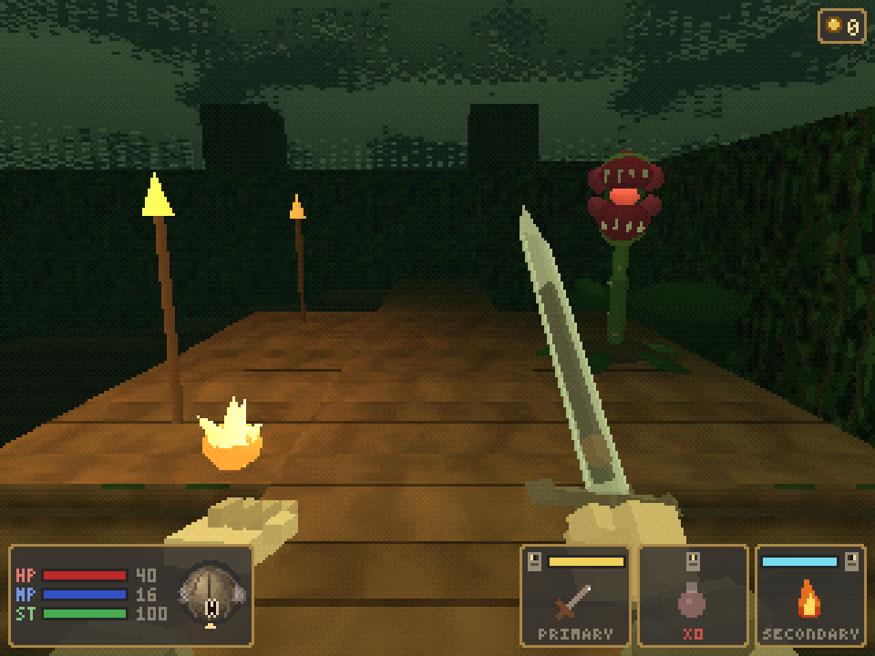
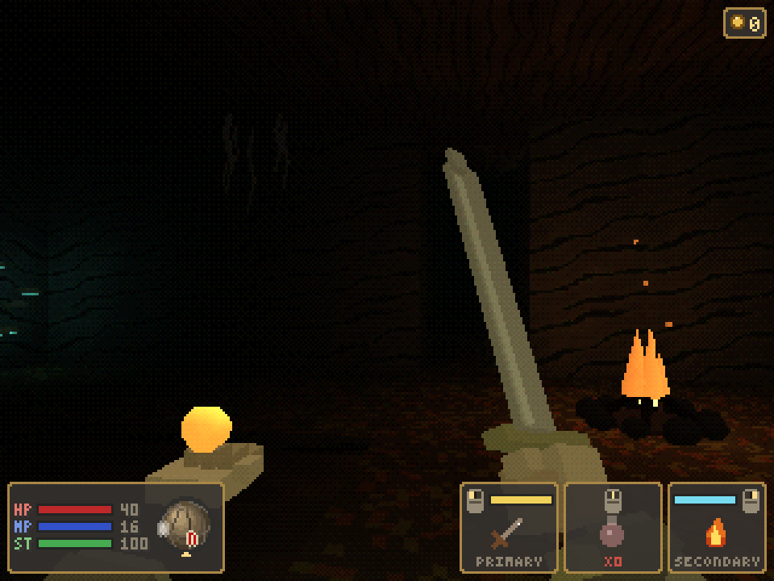
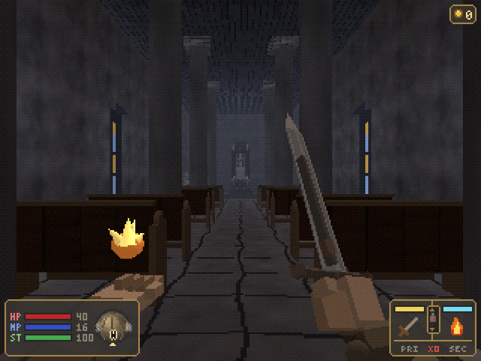
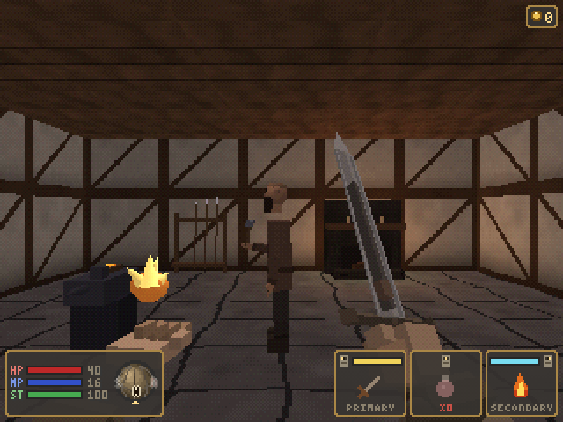
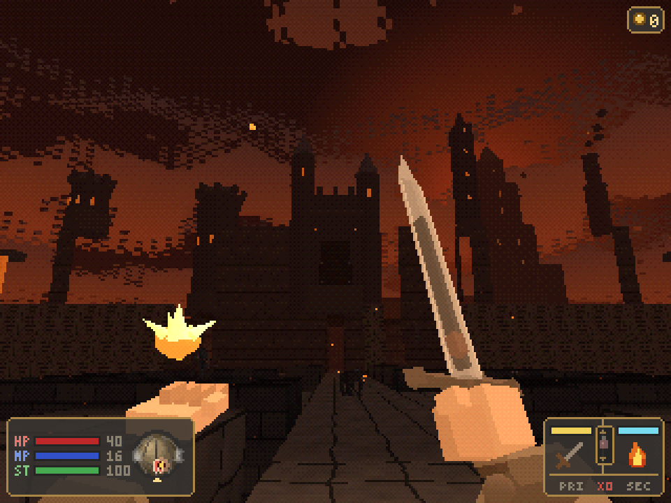
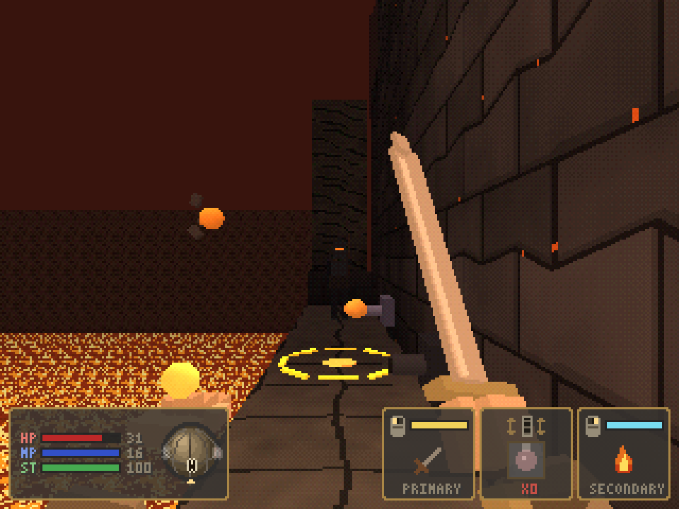
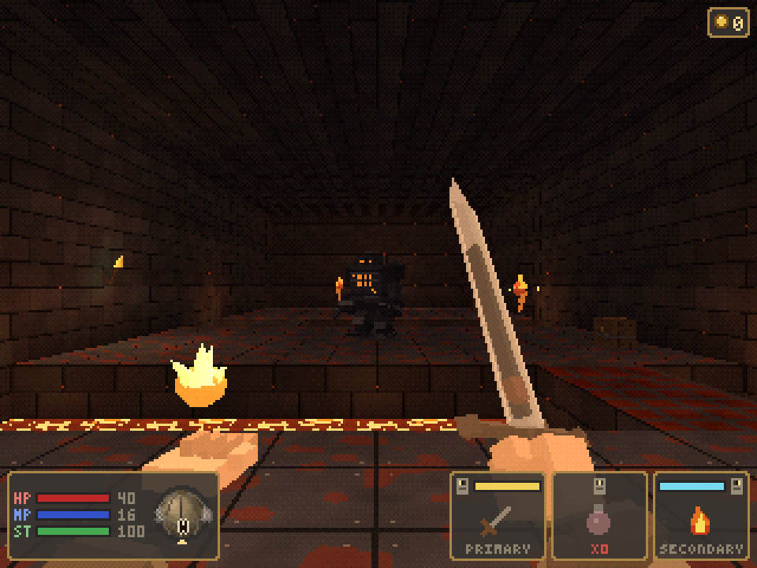
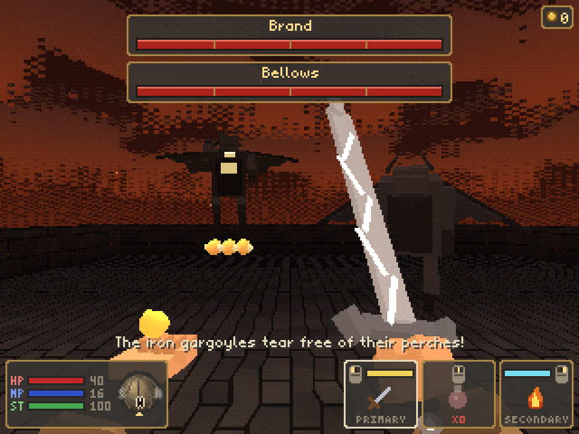

<p align="center">
  
</p>

<p align="center">
  A slow, atmospheric first-person dungeon crawler with PS1-era graphics.<br>
  Written in Python with <a href="https://github.com/electronstudio/raylib-python-cffi">raylib</a>.
  Every texture, model and sound is generated in code.
</p>

---

The bell of Harrowmere has cracked. Beneath the village well, the drowned halls of the Sunken Keep have
begun to stir, and at the end of a green trail out of the square a cave opens on the jungle of the
Verdant Hollow, which has swallowed the old woodcutters' camp. Up the north road, past a long bridge over
a gorge of fire, the forges of the Cinderhold burn again, and two iron gargoyles keep watch from its roof.
Take up a rusted sword, bring back the Ember Sigil from the keep, the Verdant Sigil from the hollow and the
Iron Sigil from the Cinderhold, and let the bell sing again.

### Inspiration

Ashen Vault is a love letter to **FromSoftware's *King's Field*** series, the slow, first-person
dungeon crawlers from the early PlayStation era that later led to *Demon's Souls* and *Dark Souls*.
It borrows their spirit: a lonely descent through dark stone halls, deliberate stamina-gauge combat,
magic learned from scrolls, and a world that tells its story through the places you walk.

It is a fan project, not a remake. All names, maps, monsters, story, art and sound are original, and
the game is not affiliated with or endorsed by FromSoftware. *King's Field* is a trademark of
FromSoftware, Inc.

## Screenshots

<table>
  <tr>
    <td></td>
    <td></td>
  </tr>
  <tr>
    <td align="center"><sub>Title screen</sub></td>
    <td align="center"><sub>The Silent Bell, at the heart of Harrowmere</sub></td>
  </tr>
  <tr>
    <td></td>
    <td></td>
  </tr>
  <tr>
    <td align="center"><sub>Odrin, keeper of the silent bell</sub></td>
    <td align="center"><sub>Flame Bolt against a Bone Walker</sub></td>
  </tr>
  <tr>
    <td></td>
    <td></td>
  </tr>
  <tr>
    <td align="center"><sub>The Ashen Warden</sub></td>
    <td align="center"><sub>Belongings, with a spinning item preview</sub></td>
  </tr>
  <tr>
    <td></td>
    <td></td>
  </tr>
  <tr>
    <td align="center"><sub>The Verdant Hollow, through the cave at the end of Harrowmere's green trail</sub></td>
    <td align="center"><sub>A Bark Husk: circle it and strike the glow in its back</sub></td>
  </tr>
  <tr>
    <td></td>
    <td></td>
  </tr>
  <tr>
    <td align="center"><sub>The woodcutters' log rack, waiting for climbers</sub></td>
    <td align="center"><sub>The Loom Mother</sub></td>
  </tr>
  <tr>
    <td></td>
    <td></td>
  </tr>
  <tr>
    <td align="center"><sub>The green trail out of Harrowmere, ending at the cave</sub></td>
    <td align="center"><sub>Mossmouth: a cold brazier kindled with Pyre</sub></td>
  </tr>
  <tr>
    <td></td>
    <td></td>
  </tr>
  <tr>
    <td align="center"><sub>The Canopy Walk, the long way to the Loom Mother</sub></td>
    <td align="center"><sub>A bonfire in the Root Caverns, under the bog</sub></td>
  </tr>
  <tr>
    <td></td>
    <td></td>
  </tr>
  <tr>
    <td align="center"><sub>Katana and shield, one in each hand</sub></td>
    <td align="center"><sub>Corvane's blades, for those who have proven themselves</sub></td>
  </tr>
  <tr>
    <td></td>
    <td></td>
  </tr>
  <tr>
    <td align="center"><sub>The cathedral, where the Enthroned sits</sub></td>
    <td align="center"><sub>Brannoc's forge</sub></td>
  </tr>
  <tr>
    <td></td>
    <td></td>
  </tr>
  <tr>
    <td align="center"><sub>Riding the cage lift down into the Undercroft</sub></td>
    <td align="center"><sub>The Butcher, waiting in his slaughter hall</sub></td>
  </tr>
  <tr>
    <td></td>
    <td></td>
  </tr>
  <tr>
    <td align="center"><sub>The long bridge to the Cinderhold, up Harrowmere's north road</sub></td>
    <td align="center"><sub>The postern ledge: a magma bomb about to land, a bowman waiting</sub></td>
  </tr>
  <tr>
    <td></td>
    <td></td>
  </tr>
  <tr>
    <td align="center"><sub>The foundry, where a Forge Golem guards the lava channels</sub></td>
    <td align="center"><sub>Brand and Bellows, the twin gargoyles on the roof</sub></td>
  </tr>
</table>

## Features

- **PS1-style renderer**: 320×240 internal resolution, vertex snapping, affine texture warping,
  15-bit color with ordered dithering, distance fog and baked vertex lighting, under skies of drifting
  cloud with a sun glowing through them and mist along the horizon.
- **Deliberate, weighty combat**: an ATK gauge that refills between swings, enemy wind-ups you can read
  and interrupt, and bosses with poise and attacks of their own: the Ashen Warden cleaves all around,
  leaps, flings embers, chains three cuts together and slams a shockwave through the floor, and at
  half health his blade catches fire and he calls flame up from beneath your feet; above his hall the
  Butcher swings a cleaver all around him, lunges and hacks, and at half health flies into a frenzy
  of floor-shaking chops; the Loom Mother
  sweeps, spits webs, pounces and calls her brood; and on the Cinderhold's roof two iron gargoyles fight
  as a pair: Brand sweeps, claws, leaps and slams, Bellows hovers, rakes the roof with fiery breath and
  swoops straight through you. They take turns, and when one falls the other flies into a rage.
- **Deaths that linger**: every foe collapses in its own way (skeletons topple, slimes melt, the
  spider curls its legs) and then burns away to drifting ash.
- **Weapons with their own movesets**: swords, greatswords, katanas, whips, maces, clubs, axes and a
  war hammer, each swinging at its own speed. Tap to attack, hold for a heavy attack, double-click for
  the weapon's own quick attack (a twin cut, a pommel crack, a double crack of the whip...). Every
  swing costs stamina, and a weapon's weight (light, medium, heavy or great) sets how much, how hard
  it hits and how fast it swings. Some weapons hide a secret attack.
- **Two slots**: put a weapon, a shield or a spell in either slot; the left mouse button works
  Primary and the right button Secondary. Two-handed weapons fill both and swing from the left button
  only. A raised shield stops blows from the front for stamina, and you can still back off and sidestep
  behind it. The best gear needs a higher level.
- **Armor you can see**: body armor and gauntlets change the sleeves and hands you see in first person.
- **Spells**: Flame Bolt, Mend and Lumen, paid for with MP once your focus has returned, Ashen Ward (embers
  that blunt every blow) in the keep, and three more
  hidden in the hollow: Venom Dart (a sting that keeps eating at its target), Veil of Mist (ordinary foes
  overlook you until you strike) and Pyre (a short gout of fire that burns plants and kindles cold fires),
  and two in the Cinderhold: Thunder Spear (a fast bolt of lightning that bites iron and jolts it) and
  Arcane Motes (three slow sparks that seek out foes on their own).
- **Elements**: iron foes conduct lightning and shrug off fire. The Stormbrand sword carries lightning,
  the Slagbreaker maul sets what it strikes alight.
- **Stamina**: sprinting, swinging and blocking drain a green stamina bar. Run it dry and you are
  winded until it recovers.
- **Four hand-built areas**: the town of Harrowmere, the Sunken Keep below its well, the
  Verdant Hollow at the end of the green trail and the Cinderhold up the north road, with locked doors,
  levers, a flooded cellar and chests.
- **A town to come home to**: Harrowmere climbs from its harbour through a market and the Bell Square,
  where the cracked Silent Bell hangs, to a cathedral on the hill where an ancient figure sits enthroned.
  Ten villagers live there: a smith, a herbalist, a trader and a swordsmith keep shops with spinning
  item previews (the swordsmith only for those who have proven themselves), and some hand a newcomer a
  weapon, a shield, remedies or a scroll.
- **A keep that fights back**: floor spikes, swinging pendulum blades and floors that crumble into the
  dark, plus barrels, crates and urns to smash for a few coins, and secrets for those who look closely.
- **A keep that folds back on itself**: barred cage lifts sink to a skull-walled Undercroft below the
  cells and climb to the Warden's Gallery above his door, where the Butcher waits among his hooks with a
  cleaver worth taking. Some lifts are chained fast until you free their winch from the far side,
  opening shortcuts back to the shrine. Hooded Gaolers drag you in on hooked
  chains, and not every heap of bones stays a heap.
- **A jungle that fights back too**: a river with a ford, a drifting raft and rotting planks; thorn
  beds; a ravine crossed on crumbling ledges; a slope where a log rack rolls its logs at climbers;
  choking spore pods in a stilt cabin; and an abandoned woodcutters' camp to rummage through, whose
  cabin floor gives way into its cellar. Long drops hurt, and the hollow keeps a few secrets too.
- **A fortress of iron and fire**: cross a long bridge over a lava gorge while vents in the lava lob
  molten bombs at you and iron bowmen shoot from the walls, with the Cinderhold's turreted gatehouse,
  great keep and smoking stacks ahead and molten iron pouring from its walls into the gorge. Inside, lava channels cut through the foundry, flame jets guard the corridors, slag hounds
  prowl the dark smelter pits and forge golems hide an open firebox on their backs. A postern, a gate
  winch and a chained lift fold the fortress back onto its shrine.
- **Dark places**: the hollow's caves and root caverns swallow your light. Only torches, glowing
  toadstools and fires show the way, unless you burn Lumen or kindle the cold braziers and bonfires,
  which then stay lit for good.
- **A hollow that folds back on itself**: the way to the Loom Mother runs the long way round, over a
  canopy walk in the treetops. Barred doors, wooden-lever lifts and a drawbridge open shortcuts back to
  the shrines once you reach their far side.
- **Everything procedural**: textures, low-poly models and sound effects are all generated at startup.
  The game itself ships no image or audio files.
- **Save shrines**: pray at a stone shrine to heal and record your journey. The fallen rise again when
  you do; only bosses and mimics stay dead.

## Installing

### What you need

- **Python 3.11 or newer**. Check with `python3 --version`.
- **A GPU with OpenGL 3.3**. Any graphics card or integrated GPU from the last ten years works.
- **Linux, macOS or Windows**. The `raylib` package ships prebuilt binaries for all three, so no C
  compiler is required.

### Option 1: install it as an app (recommended for players)

[uv](https://docs.astral.sh/uv/) (or [pipx](https://pipx.pypa.io/)) installs the game into its own
isolated environment and puts an `ashen-vault` command on your PATH:

```sh
git clone <this repository's URL> my_ashen_vault
cd my_ashen_vault
uv tool install .          # or: pipx install .
ashen-vault
```

To update later, `git pull` and then run `uv tool install --force .`. To remove the game, run
`uv tool uninstall ashen-vault`.

### Option 2: run from a source checkout (recommended for development)

Install uv once ([other install methods](https://docs.astral.sh/uv/getting-started/installation/)):

```sh
curl -LsSf https://astral.sh/uv/install.sh | sh                          # Linux and macOS
powershell -c "irm https://astral.sh/uv/install.ps1 | iex"               # Windows
```

Then, on any platform:

```sh
git clone <this repository's URL> my_ashen_vault
cd my_ashen_vault
uv run ashen-vault
```

`uv run` creates `.venv`, installs the exact versions pinned in `uv.lock` (including dev tools) and
starts the game. It also downloads a matching Python if you don't have one. `uv run python -m
ashen_vault` works too.

Without uv, plain pip works: `python3 -m venv .venv`, `.venv/bin/pip install -e .`, then
`.venv/bin/ashen-vault`.

### Troubleshooting

| Problem | Fix |
| --- | --- |
| `GLFW: Error: 65548 ... Wayland: The platform does not provide the window position` | Harmless warning on Wayland. The game runs normally. |
| Window opens but no sound | No audio device was found. The game keeps running silently. |
| OpenGL errors or a black window on Linux | Install your distribution's Mesa / OpenGL drivers (e.g. `mesa` on Arch, `libgl1` on Debian/Ubuntu). |
| `No matching distribution found for raylib` | Your Python version or platform has no prebuilt `raylib` wheel. Try a different recent CPython release on x86_64 or arm64. |
| Want to start over | Delete the save file (see [Save file](#save-file)). |

## Controls

| Action | Keys |
| --- | --- |
| Move / strafe | W S / A D (or arrow up/down) |
| Sprint | Hold Shift |
| Turn / look | Mouse |
| Primary / Secondary | Left mouse / right mouse |
| Heavy attack | Hold the button, then release |
| Quick attack | Double-click |
| Block | Hold the button of the slot with the shield |
| Cast spell | The button of the slot holding the spell |
| Equip, ready a spell | Belongings (Tab): 1 for Primary, 2 for Secondary, or Enter / click to choose |
| Use, talk, open | E |
| Belongings | Tab or I; A / D (or Left / Right) switch tabs |
| Quick item / choose quick item | Middle mouse / mouse wheel |
| Pause | Esc |
| Menus | Up/Down, Enter, Esc, or point, click, right-click and scroll with the mouse |

The same list is in the game under **Controls** on the title and pause menus.

## Tips

- The mouse in the bottom right shows your slots: Primary on its left button, Secondary on its
  right one and your quick item on the wheel. HP, MP, ST (with their numbers) and a small compass
  share the bottom-left box; an ember on the compass points to the nearest boss still alive in the
  area. Spell MP costs are listed in Belongings and in the shop.
- Your gold shows in the top right corner. Gold you pick up lingers as a "+N" under it for a moment,
  then counts into the total.
- Your swing damage scales with the **ATK** gauge: the gold bar on your weapon's mouse button. Wait for it to
  fill and the button to flash before swinging.
- Spells need your **focus** back as well as enough MP. The cyan bar on the spell's button refills after
  each cast and flashes when you can cast again.
- Hold a button to charge a **heavy attack**: an orange bar fills over the gauge, then release.
  Heavies cost more ST than light swings, and the bar turns red when you are too winded.
  Belongings and the shop show each weapon's light and heavy attack, its weight, the ST its light,
  heavy and quick attacks cost (in % of the bar), and `???` where a weapon hides a secret you have not
  found yet.
- Sprinting and every swing drain **ST** (green bar). Empty it and you can neither sprint nor swing
  until it is about a third full. Holding a shield up slows its refill.
- Your gear has weight. The **Load** line in Belongings shows it against what your STR can carry:
  a Heavy or Overloaded load slows your stride and ST refill and makes every swing cost more.
  Before you equip or buy, the stats show what would change (hover an item, or a slot in the
  Primary / Secondary chooser): green is better, red is worse. Spells compare their power as **SPL**.
- Find a copy of gear you already own and it is sold for you on the spot: half its price in gold.
- A great door guards each boss. Fall in there and only fog remains: the boss can come through it
  after you, but stepping through yourself (E) starts the fight, and there is no leaving until one of
  you falls.
- Big weapons swing slowly and cost more ST, above all for heavies; katanas, whips and fists are quick.
- Watch for enemies raising their weapons. A solid hit during the wind-up staggers most of them.
- Every menu works with the mouse: point at a row to select it, click to use or buy, right-click to
  close.
- In Belongings, press 1 or 2 on a weapon, a shield or a spell to put it in Primary or Secondary, or
  Enter (or a click) to choose a slot. The Equipped panel shows what each slot holds; rows show `[1]`,
  `[2]` or `[1+2]` for the slots holding them and `[Worn]` for armor. An empty slot fights with its
  fist, harder in gauntlets.
- You ready one spell at a time: pick it from the spell rows in Belongings. The mouse wheel only
  switches between quick items.
- Traps keep a rhythm. Watch the spikes and blades for a moment before you cross, and don't stand
  still on cracked stone.
- Step onto a lift and it carries you; wait at its landing and it comes to you. If its chain won't
  budge, look for the winch lever at the other end.
- When the Warden raises his blade in both hands, back away: the slam reaches all around him. Once his
  blade burns, keep moving off the glowing circles on the floor.
- The Butcher is slow but hits hard. Wait out his wind-up, strike after the blow, and back off when
  he raises the cleaver in both hands.
- Not every wall is a wall, and not every chest is a chest. Not every stump is a stump, either.
- In the jungle, keep moving on ledges and rotten planks, and wait in the notches of the log slope
  for each log to pass. Tree creatures turn slowly: get behind them, or set them alight.
- A door that won't open from your side is barred from the other. Find the way round.
- Spells fly where you look: aim down at slimes.
- Lava sears away a third of your health in a moment. Flame jets hiss and glow before they roar: wait for
  the gout to die, then go. On the bridge, watch for glowing circles: a bomb is about to land there.
- Iron things hate lightning. Get behind a forge golem and strike its open firebox.
- The gargoyles take turns. Keep a chimney between you and Bellows's breath, and step sideways out of its
  line of fire circles.
- Talk to everyone in Harrowmere before you descend. They have gifts and directions.

## Save file

The game saves only at shrines, to `~/.local/share/ashen_vault/save.json` (Windows:
`%USERPROFILE%\.local\share\ashen_vault\save.json`). Set the `ASHEN_VAULT_SAVE` environment variable
to use a different path.

## Development

The project uses [uv](https://docs.astral.sh/uv/) for environments and dependencies,
[ruff](https://docs.astral.sh/ruff/) for linting and formatting, and pytest with
[pytest-cov](https://pytest-cov.readthedocs.io/) for tests and coverage. All of them are configured in
`pyproject.toml` and pinned in `uv.lock`.

```sh
uv run pytest               # headless tests: maps, collision, combat, AI, saves, mesh building
uv run pytest --cov         # same, with a branch-coverage report (fails under the floor in pyproject.toml)
uv run ruff check           # lint (add --fix to auto-fix)
uv run ruff format          # format
uv add <package>            # add a runtime dependency; `uv add --dev <package>` for a dev tool
```

CI runs the same checks on every push and pull request (`.github/workflows/ci.yml`).

### Tool versions and editor settings

- Python and uv versions are pinned in `mise.toml`, `.tool-versions` and `.python-version`. With
  [mise](https://mise.jdx.dev), run `mise install` once; asdf users get the same versions from
  `.tool-versions`, and uv reads `.python-version`. Keep all three in sync when bumping.
- mise also has tasks for the commands above: `mise run play`, `test`, `lint`, `fmt` and `check`
  (`check` runs everything CI runs).
- `.editorconfig` sets UTF-8, LF line endings, a final newline, trimmed whitespace and 4-space
  indents (2 for TOML/YAML/JSON/Markdown). Most editors pick it up automatically; JetBrains and
  VS Code with the EditorConfig extension both do.

### AI coding agents

`AGENTS.md` describes the project, commands and conventions for coding agents. `CLAUDE.md` imports
it, so Claude Code, Codex, Cursor and Copilot all follow the same rules.

### Project layout

| Path | What lives there |
| --- | --- |
| `src/ashen_vault/world/`, `player/`, `ai/`, `save/` | Game logic with no raylib dependency, covered by `tests/` |
| `src/ashen_vault/render/` | PS1 shaders, procedural textures, map mesh builder, matrix rig, low-poly models |
| `src/ashen_vault/game.py` | Scenes and the main loop |
| `src/ashen_vault/ui/hud.py` | HUD (vitals, compass, the mouse with Primary / quick item / Secondary, the gold counter), menus and dialogue boxes |
| `src/ashen_vault/ui/tally.py` | How the gold counter holds a fresh "+N" and then counts it in |
| `src/ashen_vault/ui/smallfont.py`, `ui/logofont.py`, `ui/tinyfont.py` | The pixel font for all game text, the logo's capitals for the title and big headings, and the HUD's tiny capitals and digits |
| `src/ashen_vault/ui/belongings.py` | What the Belongings menu shows: its tabs and the Primary and Secondary slots |
| `src/ashen_vault/audio/synth.py` | Synthesized sound effects |
| `src/ashen_vault/maps/*.map` | Plain-text tile maps (`[meta]`, `[legend]`, `[grid]`, `[entities]`) |
| `src/ashen_vault/world/hazards.py`, `world/terrain.py` | Traps (spikes, blades, crumbling floors, flame jets, magma vents) and boss fire; terrain (lifts, river, ravine, ledges, logs, spores) |
| `src/ashen_vault/world/elements.py` | Lightning against iron, fire against what was forged in it |
| `src/ashen_vault/world/arena.py` | Boss arenas: the great door that seals behind you, and the fog left after you fall |
| `src/ashen_vault/player/burden.py`, `ui/compare.py` | Equipment load and what it costs you; what equipping an item would change |
| `src/ashen_vault/render/forge_models.py` | The Cinderhold's foes, the twin gargoyles, its weapons, shots, fortress dressing and skyline |
| `src/ashen_vault/render/shapes.py` | Extra low-poly shapes for models: pointed blades, lozenge bars and wedges |
| `src/ashen_vault/world/sky.py`, `render/sky.py` | Each map's sky (gradient, sun, clouds, mist), built as plain geometry and drawn behind the world |
| `src/ashen_vault/dialogue.py` | NPC conversations |
| `docs/logo/make_logo.py` | Generates the pixel-art logo SVG (its letters come from `ui/logofont.py`) |

### Debug flags

```sh
uv run ashen-vault --map sunken_keep --at 15,21,180 --smoke 100 --script "wait:1.2 attack" --shot out.png
```

- `--map NAME` skips the title screen and starts on that map.
- `--at TX,TZ,YAW` sets the start tile and heading in degrees. Write a negative heading as
  `--at=15,7,-90`, or it is read as a flag.
- `--smoke N` runs N frames at a fixed timestep, writes a 3× screenshot and prints a state summary
  (position, height `y=`, HP, flags, items, gear and every enemy's state).
- `--script "..."` drives input: `action` presses once, `action:1.5` holds for 1.5 s, `wait:1` pauses.
- `--shot PATH` sets where `--smoke` writes its screenshot.
- `--equip right=katana,left=buckler,body=brigandine,hands=iron_gauntlets` starts with that gear
  (`primary=` / `secondary=` also name the `right` / `left` slots; `none`
  empties a slot, `left=spell` readies the spell there and `left=spell:pyre` learns and readies Pyre),
  and `--level N` at that level (for equipment requirements only: HP and stats stay at level 1).

The README screenshots were taken this way, each with `ASHEN_VAULT_SAVE` pointing at a fresh throwaway
file. The title is `uv run ashen-vault --smoke 60 --shot title.png` and the village
`uv run ashen-vault --map harrowmere --at=22,30,-60 --smoke 40 --shot village.png`; Odrin is
`uv run ashen-vault --map harrowmere --at=28,25,-90 --smoke 40 --script "wait:0.2 interact" --shot dialogue.png`,
Belongings is
`uv run ashen-vault --map harrowmere --level 6 --equip primary=katana,secondary=round_shield,body=brigandine,hands=chain_mitts --smoke 40 --script "wait:0.2 menu" --shot inventory.png`,
Corvane's shop is
`uv run ashen-vault --map harrowmere --at=6,26,180 --level 7 --smoke 220 --script "forward:2 interact wait:0.3 confirm wait:0.3 confirm wait:0.3 confirm wait:0.3 confirm" --shot corvane.png`,
the cathedral is `uv run ashen-vault --map harrowmere --at=18,6,180 --smoke 40 --shot cathedral.png`,
the forge is `uv run ashen-vault --map harrowmere --at=8,18,180 --smoke 40 --shot forge.png`,
the Warden is `uv run ashen-vault --map sunken_keep --at=15,7,-90 --smoke 40 --shot warden.png`,
the hollow's vine path is `uv run ashen-vault --map verdant_hollow --at=9,12,90 --smoke 40 --shot verdant_hollow.png`,
the Bark Husk is `uv run ashen-vault --map verdant_hollow --at=26,17,-90 --smoke 60 --shot bark_husk.png`,
the log rack is `uv run ashen-vault --map verdant_hollow --at=51,6,180 --smoke 40 --shot log_rack.png`,
the flame bolt shot is
`uv run ashen-vault --map sunken_keep --at 15,22,0 --smoke 40 --script "wait:0.3 cast" --shot flame_bolt.png`,
the Loom Mother is `uv run ashen-vault --map verdant_hollow --at=15,7,-90 --smoke 40 --shot loom_mother.png`,
the lift ride is
`uv run ashen-vault --map sunken_keep --at 4,24,90 --smoke 560 --script "forward:0.9 wait:5 forward:0.3" --shot undercroft_lift.png`,
the Butcher is `uv run ashen-vault --map sunken_keep --at=27,7,-90 --smoke 20 --shot gallery.png`,
the jungle trail is `uv run ashen-vault --map harrowmere --at=56,34,-90 --smoke 40 --shot jungle_trail.png`,
Mossmouth is
`uv run ashen-vault --map verdant_hollow --at=15,31,180 --equip left=spell:pyre --script "wait:0.3 cast wait:3" --smoke 120 --shot mossmouth.png`,
the canopy is `uv run ashen-vault --map verdant_hollow --at=31,3,180 --script "look_down:0.12" --smoke 40 --shot canopy_walk.png`,
the Root Caverns are `uv run ashen-vault --map verdant_hollow --at=6,38,-100 --smoke 25 --shot root_caverns.png`,
the long bridge is `uv run ashen-vault --map cinderhold --at=29,52,-90 --script "look_up:0.15" --smoke 60 --shot cinderhold_bridge.png`,
the postern ledge is `uv run ashen-vault --map cinderhold --at=28,30,180 --smoke 190 --shot postern_ledge.png`,
the foundry is `uv run ashen-vault --map cinderhold --at=18,17,180 --smoke 40 --shot foundry.png`,
the gargoyles are
`uv run ashen-vault --map cinderhold --at=30,6,180 --level 10 --equip right=stormbrand --smoke 200 --script "wait:1 attack wait:1" --shot gargoyles.png`,
and the katana and shield shot is
`uv run ashen-vault --map sunken_keep --at 15,22,0 --level 8 --equip primary=katana,secondary=round_shield,body=brigandine,hands=iron_gauntlets --smoke 100 --shot combat.png`.

## Contributing

Contributions are welcome! See [CONTRIBUTING.md](CONTRIBUTING.md) for setup, the checks to run, and
the commit sign-off. Pull requests go against the `development` branch.

---

Released in 2026. This project is under the [GPL-3.0](LICENSE) license.

By [Victor B. Fiamoncini](https://github.com/Victor-Fiamoncini) ☕️
