<p align="center">
  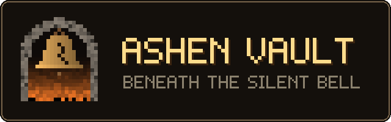
</p>

<p align="center">
  A slow, atmospheric first-person dungeon crawler with PS1-era graphics.<br>
  Written in Python with <a href="https://github.com/electronstudio/raylib-python-cffi">raylib</a>.
  Every texture, model and sound is generated in code.
</p>

---

The bell of Harrowmere has cracked. Beneath the village well, the drowned halls of the Sunken Keep have
begun to stir, and behind an overgrown house the jungle of the Verdant Hollow has swallowed the old
woodcutters' camp. Take up a rusted sword, bring back the Ember Sigil from the keep and the Verdant
Sigil from the hollow, and let the bell sing again.

### Inspiration

Ashen Vault is a love letter to **FromSoftware's *King's Field*** series, the slow, first-person
dungeon crawlers from the early PlayStation era that later led to *Demon's Souls* and *Dark Souls*.
It borrows their spirit: a lonely descent through dark stone halls, deliberate stamina-gauge combat,
magic learned from scrolls, and a world that tells its story through the places you walk.

It is a fan project, not a remake. All names, maps, monsters, story, art and sound are original, and
the game is not affiliated with or endorsed by FromSoftware. *King's Field* is a trademark of
FromSoftware, Inc.

## Screenshots

<table>
  <tr>
    <td>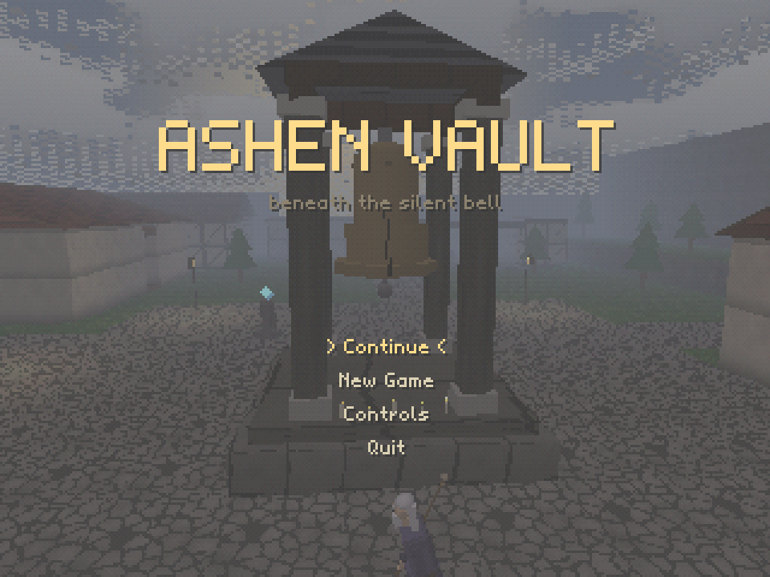</td>
    <td>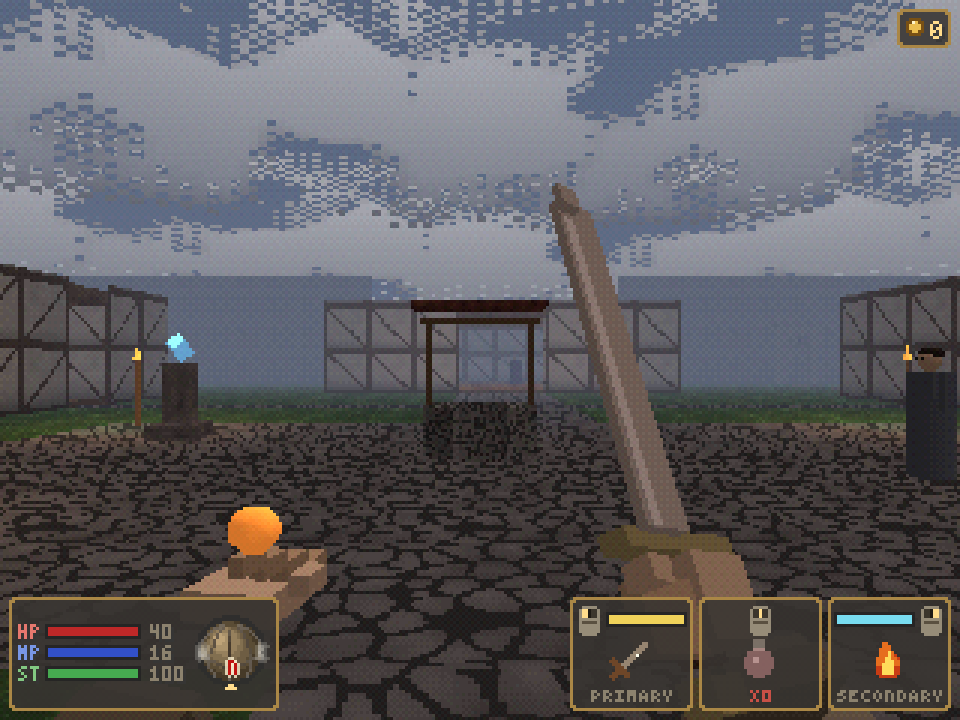</td>
  </tr>
  <tr>
    <td align="center"><sub>Title screen</sub></td>
    <td align="center"><sub>Harrowmere, the village above the keep</sub></td>
  </tr>
  <tr>
    <td>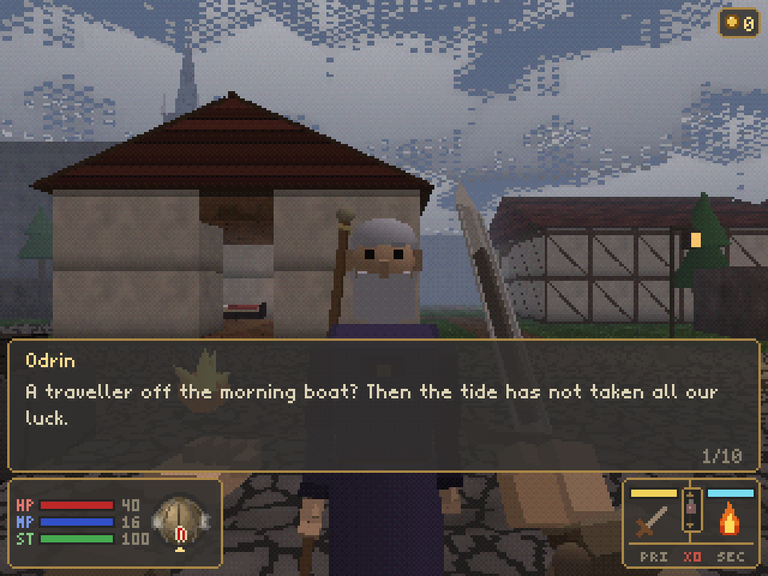</td>
    <td>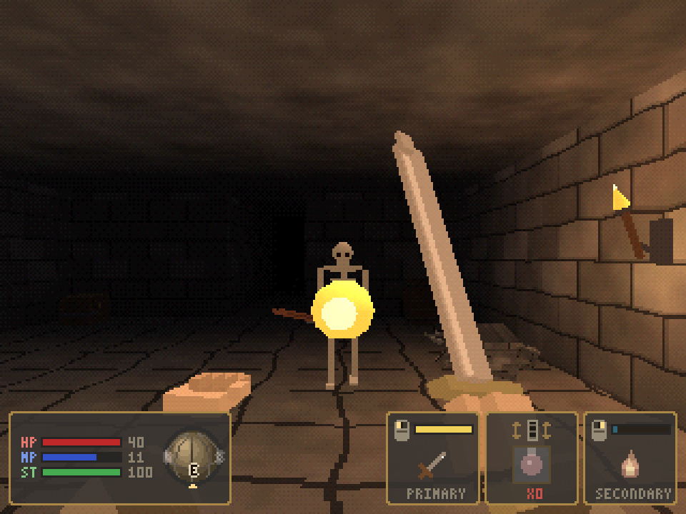</td>
  </tr>
  <tr>
    <td align="center"><sub>Odrin, keeper of the silent bell</sub></td>
    <td align="center"><sub>Flame Bolt against a Bone Walker</sub></td>
  </tr>
  <tr>
    <td>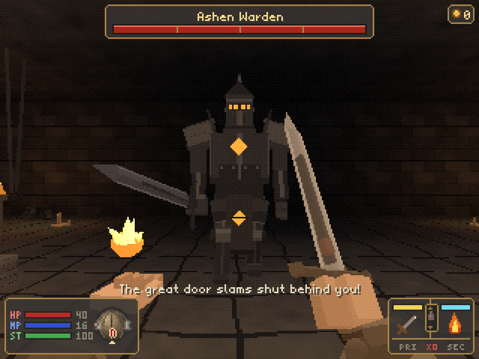</td>
    <td>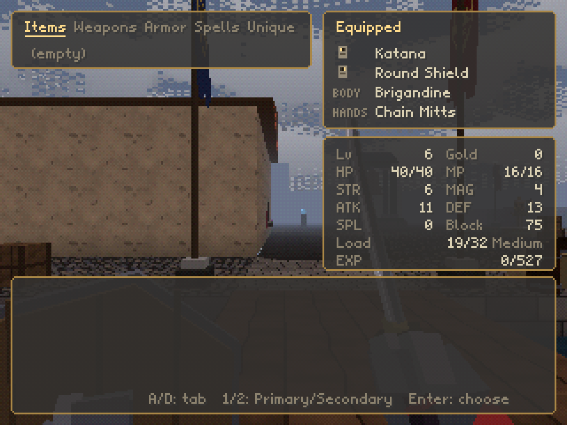</td>
  </tr>
  <tr>
    <td align="center"><sub>The Ashen Warden</sub></td>
    <td align="center"><sub>Belongings, with a spinning item preview</sub></td>
  </tr>
  <tr>
    <td>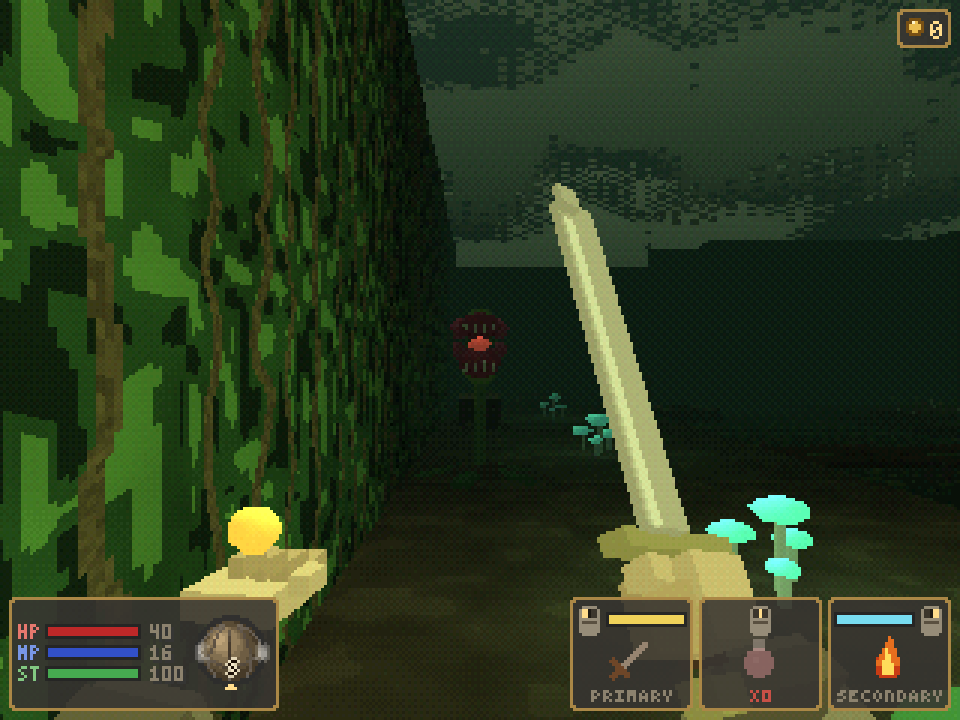</td>
    <td>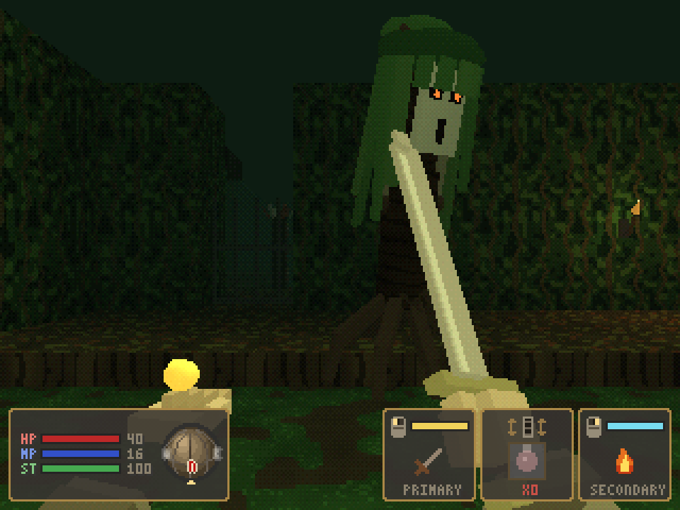</td>
  </tr>
  <tr>
    <td align="center"><sub>The Verdant Hollow, behind Harrowmere's overgrown house</sub></td>
    <td align="center"><sub>A Bark Husk: circle it and strike the glow in its back</sub></td>
  </tr>
  <tr>
    <td>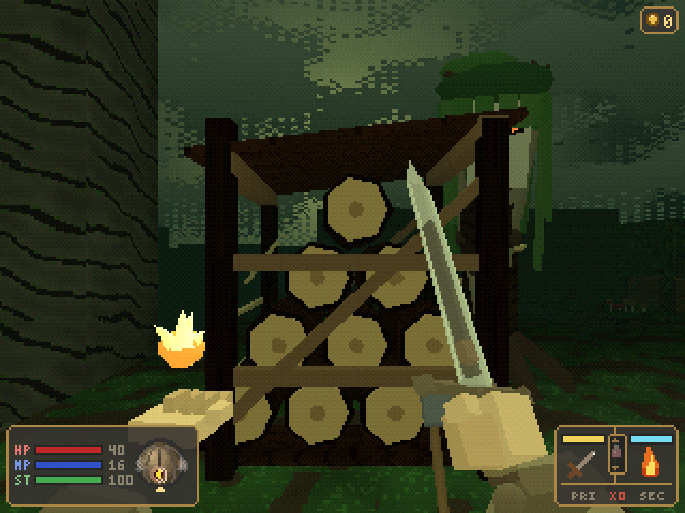</td>
    <td>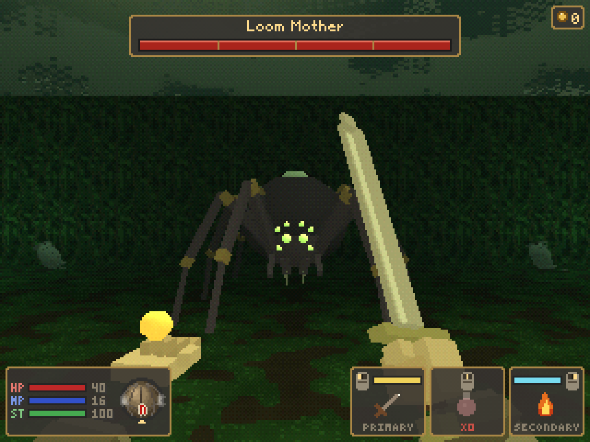</td>
  </tr>
  <tr>
    <td align="center"><sub>The woodcutters' log rack, waiting for climbers</sub></td>
    <td align="center"><sub>The Loom Mother</sub></td>
  </tr>
  <tr>
    <td>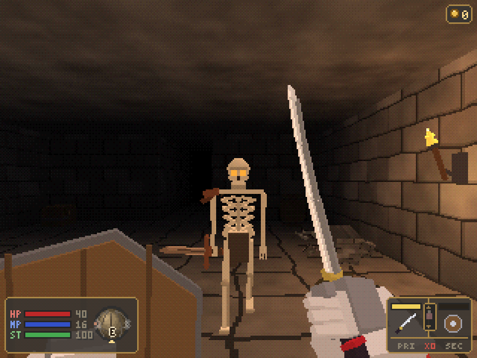</td>
    <td>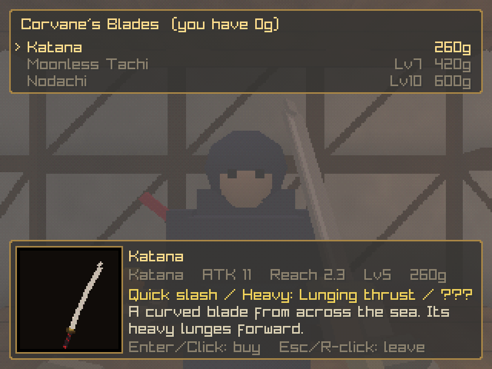</td>
  </tr>
  <tr>
    <td align="center"><sub>Katana and shield, one in each hand</sub></td>
    <td align="center"><sub>Corvane's blades, for those who have proven themselves</sub></td>
  </tr>
  <tr>
    <td>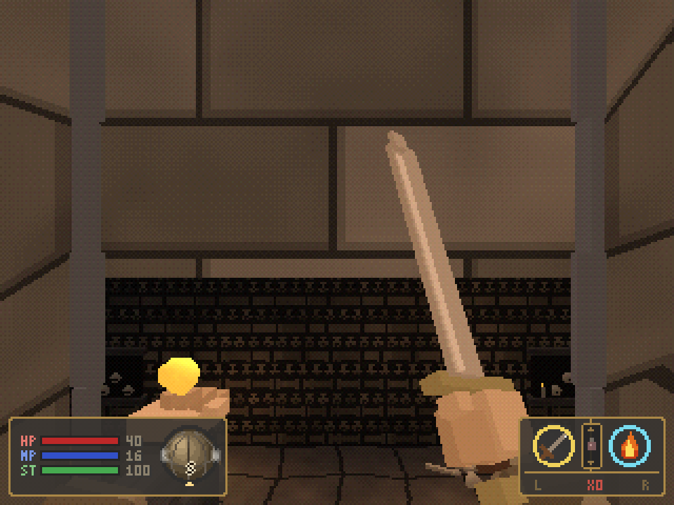</td>
    <td>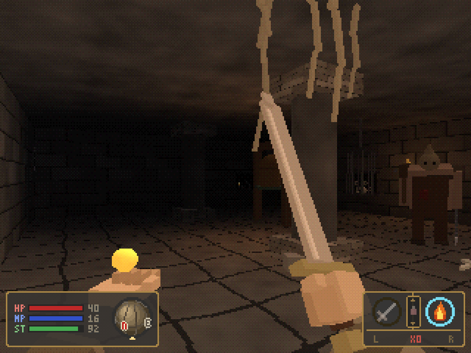</td>
  </tr>
  <tr>
    <td align="center"><sub>Riding the lift down into the Undercroft</sub></td>
    <td align="center"><sub>The Warden's Gallery, and a Gaoler with his hooked chain</sub></td>
  </tr>
</table>

## Features

- **PS1-style renderer**: 320×240 internal resolution, vertex snapping, affine texture warping,
  15-bit color with ordered dithering, distance fog and baked vertex lighting.
- **Deliberate, weighty combat**: an ATK gauge that refills between swings, enemy wind-ups you can read
  and interrupt, and bosses with poise and attacks of their own: the Ashen Warden cleaves all around,
  leaps, flings embers, chains three cuts together and slams a shockwave through the floor, and at
  half health his blade catches fire and he calls flame up from beneath your feet; the Loom Mother
  sweeps, spits webs, pounces and calls her brood.
- **Deaths that linger**: every foe collapses in its own way (skeletons topple, slimes melt, the
  spider curls its legs) and then burns away to drifting ash.
- **Weapons with their own movesets**: swords, greatswords, katanas, whips, maces, clubs, axes and a
  war hammer, each swinging at its own speed. Tap to attack, hold for a heavy attack, click again
  mid-swing for a quick follow-up. Every swing costs stamina, and some weapons hide a secret attack.
- **Two hands**: hold a weapon, a shield or a spell in either hand; the left mouse button works the
  right hand and the right button the left. Two-handed weapons fill both. A raised shield stops blows
  from the front for stamina. The best gear needs a higher level.
- **Armor you can see**: body armor and gauntlets change the sleeves and hands you see in first person.
- **Spells**: Flame Bolt, Mend and Lumen, paid for with MP once your focus has returned.
- **Stamina**: sprinting, swinging and blocking drain a green stamina bar. Run it dry and you are
  winded until it recovers.
- **Three hand-built areas**: the village of Harrowmere, the Sunken Keep below its well and the
  Verdant Hollow behind its overgrown house, with locked doors, levers, a flooded cellar, chests, a
  shop with spinning item previews and five villagers to talk to (one of them only once you have
  proven yourself).
- **A keep that fights back**: floor spikes, swinging pendulum blades and floors that crumble into the
  dark, plus barrels, crates and urns to smash for a few coins, and secrets for those who look closely.
- **A keep that folds back on itself**: chain lifts sink to a skull-walled Undercroft below the cells
  and climb to the Warden's Gallery above his door. Some lifts are chained fast until you free their
  winch from the far side, opening shortcuts back to the shrine. Hooded Gaolers drag you in on hooked
  chains, and not every heap of bones stays a heap.
- **A jungle that fights back too**: a river with a ford, a drifting raft and rotting planks; thorn
  beds; a ravine crossed on crumbling ledges; a slope where a log rack rolls its logs at climbers;
  choking spore pods in a stilt cabin; and an abandoned woodcutters' camp to rummage through, whose
  cabin floor gives way into its cellar. Long drops hurt, and the hollow keeps a few secrets too.
- **Everything procedural**: textures, low-poly models and sound effects are all generated at startup.
  The game itself ships no image or audio files.
- **Save shrines**: pray at a stone shrine to heal and record your journey. The fallen rise again when
  you do; only bosses and mimics stay dead.

## Installing

### What you need

- **Python 3.11 or newer**. Check with `python3 --version`.
- **A GPU with OpenGL 3.3**. Any graphics card or integrated GPU from the last ten years works.
- **Linux, macOS or Windows**. The `raylib` package ships prebuilt binaries for all three, so no C
  compiler is required.

### Option 1: install it as an app (recommended for players)

[uv](https://docs.astral.sh/uv/) (or [pipx](https://pipx.pypa.io/)) installs the game into its own
isolated environment and puts an `ashen-vault` command on your PATH:

```sh
git clone <this repository's URL> my_ashen_vault
cd my_ashen_vault
uv tool install .          # or: pipx install .
ashen-vault
```

To update later, `git pull` and then run `uv tool install --force .`. To remove the game, run
`uv tool uninstall ashen-vault`.

### Option 2: run from a source checkout (recommended for development)

Install uv once ([other install methods](https://docs.astral.sh/uv/getting-started/installation/)):

```sh
curl -LsSf https://astral.sh/uv/install.sh | sh                          # Linux and macOS
powershell -c "irm https://astral.sh/uv/install.ps1 | iex"               # Windows
```

Then, on any platform:

```sh
git clone <this repository's URL> my_ashen_vault
cd my_ashen_vault
uv run ashen-vault
```

`uv run` creates `.venv`, installs the exact versions pinned in `uv.lock` (including dev tools) and
starts the game. It also downloads a matching Python if you don't have one. `uv run python -m
ashen_vault` works too.

Without uv, plain pip works: `python3 -m venv .venv`, `.venv/bin/pip install -e .`, then
`.venv/bin/ashen-vault`.

### Troubleshooting

| Problem | Fix |
| --- | --- |
| `GLFW: Error: 65548 ... Wayland: The platform does not provide the window position` | Harmless warning on Wayland. The game runs normally. |
| Window opens but no sound | No audio device was found. The game keeps running silently. |
| OpenGL errors or a black window on Linux | Install your distribution's Mesa / OpenGL drivers (e.g. `mesa` on Arch, `libgl1` on Debian/Ubuntu). |
| `No matching distribution found for raylib` | Your Python version or platform has no prebuilt `raylib` wheel. Try a different recent CPython release on x86_64 or arm64. |
| Want to start over | Delete the save file (see [Save file](#save-file)). |

## Controls

| Action | Keys |
| --- | --- |
| Move / strafe | W S / A D (or arrow up/down) |
| Sprint | Hold Shift |
| Turn / look | Mouse |
| Right hand / left hand | Left mouse / right mouse |
| Heavy attack | Hold the button, then release |
| Quick attack | Click again while a light swing is still going |
| Block | Hold the button of the hand with the shield |
| Cast spell | The button of the hand holding the spell |
| Choose spell | Belongings (Tab), then Enter or click on a spell |
| Use, talk, open | E |
| Belongings | Tab or I |
| Quick item / choose quick item | Middle mouse / mouse wheel |
| Pause | Esc |
| Menus | Up/Down, Enter, Esc, or point, click, right-click and scroll with the mouse |

The same list is in the game under **Controls** on the title and pause menus.

## Tips

- The HUD in the bottom right is drawn as a mouse: the left button shows what your right hand holds,
  the right button your left hand, and the wheel your quick item. HP, MP, ST (with their numbers) and a
  small compass share the bottom-left box. Spell MP costs are listed in Belongings and in the shop.
- Your swing damage scales with the **ATK** gauge: the gold ring around your weapon. Wait for it to close
  and flash before swinging.
- Spells need your **focus** back as well as enough MP. The cyan ring around the spell icon refills after
  each cast and flashes when you can cast again.
- Hold a button to charge a **heavy attack**: the orange ring around your weapon fills, then
  release. Heavies cost more ST than light swings, and the ring turns red when you are too winded.
  Belongings and the shop show each weapon's light and heavy attack, and `???` where a weapon hides
  a secret you have not found yet.
- Sprinting and every swing drain **ST** (green bar). Empty it and you can neither sprint nor swing
  until it is about a third full. Holding a shield up slows its refill.
- Big weapons swing slowly; katanas, whips and fists are quick.
- Watch for enemies raising their weapons. A solid hit during the wind-up staggers most of them.
- Every menu works with the mouse: point at a row to select it, click to use or buy, right-click to
  close.
- In Belongings, Enter (or a click) on a one-handed weapon, a shield or a spell asks which hand it goes
  in. Rows show `(R)`, `(L)` or `(R+L)` for what your hands hold and `(E)` for worn armor. An empty
  hand fights with its fist, harder in gauntlets.
- You ready one spell at a time: pick it from the spell rows in Belongings. The mouse wheel only
  switches between quick items.
- Traps keep a rhythm. Watch the spikes and blades for a moment before you cross, and don't stand
  still on cracked stone.
- Step onto a lift and it carries you; wait at its landing and it comes to you. If its chain won't
  budge, look for the winch lever at the other end.
- When the Warden raises his blade in both hands, back away: the slam reaches all around him. Once his
  blade burns, keep moving off the glowing circles on the floor.
- Not every wall is a wall, and not every chest is a chest. Not every stump is a stump, either.
- In the jungle, keep moving on ledges and rotten planks, and wait in the notches of the log slope
  for each log to pass. Tree creatures turn slowly: get behind them.
- Talk to everyone in Harrowmere before you descend. They have gifts and directions.

## Save file

The game saves only at shrines, to `~/.local/share/ashen_vault/save.json` (Windows:
`%USERPROFILE%\.local\share\ashen_vault\save.json`). Set the `ASHEN_VAULT_SAVE` environment variable
to use a different path.

## Development

The project uses [uv](https://docs.astral.sh/uv/) for environments and dependencies,
[ruff](https://docs.astral.sh/ruff/) for linting and formatting, and pytest with
[pytest-cov](https://pytest-cov.readthedocs.io/) for tests and coverage. All of them are configured in
`pyproject.toml` and pinned in `uv.lock`.

```sh
uv run pytest               # headless tests: maps, collision, combat, AI, saves, mesh building
uv run pytest --cov         # same, with a branch-coverage report (fails under the floor in pyproject.toml)
uv run ruff check           # lint (add --fix to auto-fix)
uv run ruff format          # format
uv add <package>            # add a runtime dependency; `uv add --dev <package>` for a dev tool
```

CI runs the same checks on every push and pull request (`.github/workflows/ci.yml`).

### Tool versions and editor settings

- Python and uv versions are pinned in `mise.toml`, `.tool-versions` and `.python-version`. With
  [mise](https://mise.jdx.dev), run `mise install` once; asdf users get the same versions from
  `.tool-versions`, and uv reads `.python-version`. Keep all three in sync when bumping.
- mise also has tasks for the commands above: `mise run play`, `test`, `lint`, `fmt` and `check`
  (`check` runs everything CI runs).
- `.editorconfig` sets UTF-8, LF line endings, a final newline, trimmed whitespace and 4-space
  indents (2 for TOML/YAML/JSON/Markdown). Most editors pick it up automatically; JetBrains and
  VS Code with the EditorConfig extension both do.

### AI coding agents

`AGENTS.md` describes the project, commands and conventions for coding agents. `CLAUDE.md` imports
it, so Claude Code, Codex, Cursor and Copilot all follow the same rules.

### Project layout

| Path | What lives there |
| --- | --- |
| `src/ashen_vault/world/`, `player/`, `ai/`, `save/` | Game logic with no raylib dependency, covered by `tests/` |
| `src/ashen_vault/render/` | PS1 shaders, procedural textures, map mesh builder, matrix rig, low-poly models |
| `src/ashen_vault/game.py` | Scenes and the main loop |
| `src/ashen_vault/ui/hud.py` | HUD, compass, menus and dialogue boxes |
| `src/ashen_vault/audio/synth.py` | Synthesized sound effects |
| `src/ashen_vault/maps/*.map` | Plain-text tile maps (`[meta]`, `[legend]`, `[grid]`, `[entities]`) |
| `src/ashen_vault/world/hazards.py`, `world/terrain.py` | Dungeon traps and the Warden's fire; terrain (lifts, river, ravine, ledges, logs, spores) |
| `src/ashen_vault/dialogue.py` | NPC conversations |
| `docs/logo/make_logo.py` | Generates the pixel-art logo SVG |

### Debug flags

```sh
uv run ashen-vault --map sunken_keep --at 15,21,180 --smoke 100 --script "wait:1.2 attack" --shot out.png
```

- `--map NAME` skips the title screen and starts on that map.
- `--at TX,TZ,YAW` sets the start tile and heading in degrees. Write a negative heading as
  `--at=15,7,-90`, or it is read as a flag.
- `--smoke N` runs N frames at a fixed timestep, writes a 3× screenshot and prints a state summary
  (position, height `y=`, HP, flags, items, gear and every enemy's state).
- `--script "..."` drives input: `action` presses once, `action:1.5` holds for 1.5 s, `wait:1` pauses.
- `--shot PATH` sets where `--smoke` writes its screenshot.
- `--equip right=katana,left=buckler,body=brigandine,hands=iron_gauntlets` starts with that gear (`none`
  empties a slot, `left=spell` readies the spell there), and `--level N` at that level.

The README screenshots were taken this way. For example, the flame bolt shot is
`uv run ashen-vault --map sunken_keep --at 15,22,0 --smoke 30 --script "wait:0.3 cast" --shot flame_bolt.png`,
the Loom Mother is `uv run ashen-vault --map verdant_hollow --at=15,7,-90 --smoke 40 --shot loom_mother.png`,
the lift ride is
`uv run ashen-vault --map sunken_keep --at 4,24,90 --smoke 560 --script "forward:0.9 wait:5 forward:0.3" --shot undercroft_lift.png`,
the gallery is `uv run ashen-vault --map sunken_keep --at=25,15,-60 --smoke 40 --shot gallery.png`,
and the katana and shield shot is
`uv run ashen-vault --map sunken_keep --at 15,22,0 --level 8 --equip right=katana,left=round_shield,body=brigandine,hands=iron_gauntlets --smoke 100 --shot combat.png`.

## Contributing

Contributions are welcome! See [CONTRIBUTING.md](CONTRIBUTING.md) for setup, the checks to run, and
the commit sign-off. Pull requests go against the `development` branch.

---

Released in 2026. This project is under the [GPL-3.0](LICENSE) license.

By [Victor B. Fiamoncini](https://github.com/Victor-Fiamoncini) ☕️
